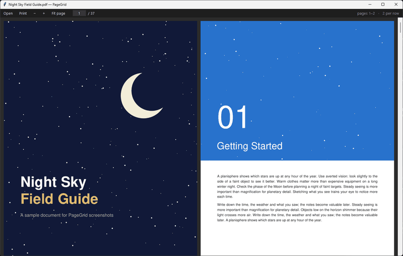
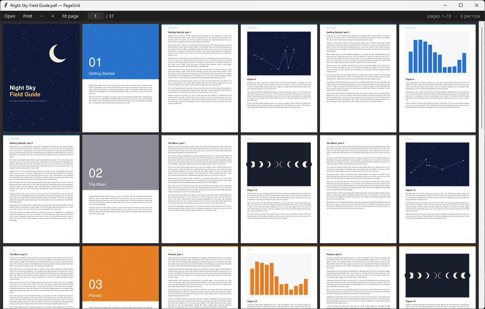
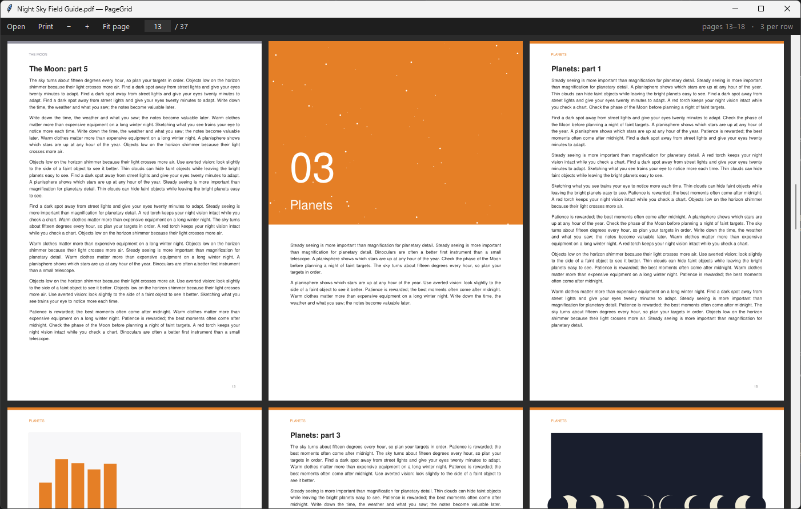
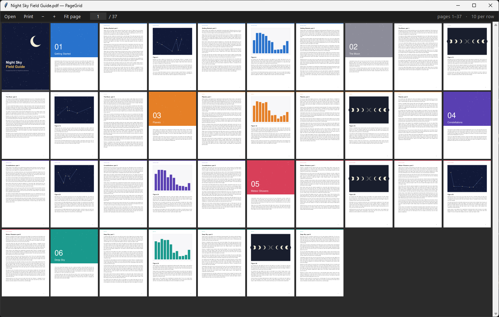

# PageGrid

A small, fast PDF reader for Windows (Python + MuPDF + Tk). It shows pages in a grid,
and **Ctrl + mouse wheel** changes how many pages fit on each row.

## Download

Download **[PageGrid.exe](https://github.com/J-o-h-n-M/pagegrid/releases/latest/download/PageGrid.exe)**
from the [latest release](https://github.com/J-o-h-n-M/pagegrid/releases/latest). It is a single
file for 64-bit Windows 10 and 11, with nothing to install.

The exe is not code-signed, so the first time you run it Windows SmartScreen shows
"Windows protected your PC". Click **More info → Run anyway** to start it.

## Screenshots

Six pages per row:

Three pages per row, for reading:

The whole 37-page document at ten pages per row:

The document in the screenshots was generated for this README.

## Use

Run `PageGrid.exe`, or `PageGrid.exe file.pdf`. You can put the exe anywhere. To make it your default PDF viewer, right-click a PDF →
*Open with* → *Choose another app* → browse to `PageGrid.exe`.

| Action | Input |
|---|---|
| Fewer / more pages per row (zoom) | Ctrl + wheel, Ctrl + `+` / `-`, toolbar `+` / `−` |
| Magnify a single page (up to 400%) | keep zooming in at 1 page per row |
| Set pages per row directly | keys `1`–`9` |
| Fit a whole page in the window | Ctrl + `0`, *Fit page* |
| Scroll | wheel, arrows, drag with the left mouse button; Shift + wheel scrolls sideways |
| Next / previous screen of rows | PageDown / PageUp, Space / Shift + Space |
| First / last page | Home / End |
| Go to a page | type it in the page box (Ctrl + G), then Enter |
| Open | Ctrl + O, or click the empty window |
| Print (printer, pages, copies) | Ctrl + P, *Print* |
| Full screen | F11 (Esc to leave) |

Besides PDF it opens e-books and documents (EPUB, MOBI, FB2, XPS, CBZ comics), images
(PNG, JPEG, BMP, GIF, TIFF, JPEG 2000, SVG and more), plain text and HTML. The Open dialog
shows all of these by default; use its file type list to narrow it down. Your pages-per-row setting and window size are saved
in `%APPDATA%\PageGrid\config.json`.

## Build

`build.bat` builds the single `dist\PageGrid.exe` in its own virtual environment (`.buildenv`),
so nothing else installed on your PC gets bundled. The single exe unpacks itself on every launch,
so it takes about 1.5 s to open a file. `build.bat folder` builds `dist\PageGrid\PageGrid.exe`
plus an `_internal` folder instead, which starts in about 0.3 s; move that whole folder together.

To run from source: `pip install pymupdf`, then `python pagegrid.py [file.pdf]`.

## License

The PageGrid source code in this repository is released under the [MIT License](LICENSE).

PageGrid uses [PyMuPDF](https://github.com/pymupdf/PyMuPDF) and the MuPDF library, which are
licensed under the [GNU AGPL-3.0](https://www.gnu.org/licenses/agpl-3.0.html) (or a commercial
license from Artifex). The released `PageGrid.exe` contains them, so each exe build as a whole
is distributed under the [AGPL-3.0](licenses/AGPL-3.0.txt). Its complete source is this
repository plus the component sources listed in [THIRD-PARTY-NOTICES.md](THIRD-PARTY-NOTICES.md).
